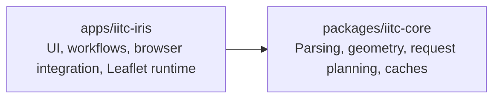

# IRIS — Ingress Intel Map for Android and Browsers

IRIS (Ingress Reconnaissance & Intelligence System) is an independent Ingress Intel map companion,
based on IITC. Use it as an Android APK or a Firefox/Chrome browser extension to explore portals,
plan links, follow player activity, and read COMM.

- Portal details, missions, inventory, passcodes, regional scores, and portal analysis.
- Player tracker with grouped markers and individual agent histories.
- Drawn links and markers, portal/address search, and optional Locate.
- OpenStreetMap and OpenFreeMap map styles, with a separate System / Dark / Light interface setting.

## Download And Try

Get the current builds from **[GitHub Releases](https://github.com/amsdams/iris-intel/releases/tag/latest)**.

| Platform | Download | Getting started |
| --- | --- | --- |
| Android 8.0+ | `iitc-iris-android.apk` | [Installation, updates, recovery, and privacy](docs/iitc-iris/friends-testing.md) |
| Chrome / Chromium | `iitc-iris-chrome.zip` | Extract and load the folder containing `manifest.json` through Developer mode. |
| Firefox | `iitc-iris-firefox.xpi` | Development build; see [temporary browser loading](#load-iitc-iris-locally). |

IRIS is an early alpha, currently shared for friends testing. Android uses an experimental WebView sign-in
compatibility workaround; saved-password support remains unresolved. It is not affiliated with or endorsed by Niantic.
See the [Android notes](apps/android-intel-spike/README.md) for known limits.

For Android updates, use **App → Check for updates** or **App → Releases**. Install the signed APK over your
existing release to preserve settings and your session. Report problems through **App → About IRIS → Feedback**
or [GitHub Issues](https://github.com/amsdams/iris-intel/issues), including the app version and steps to reproduce.

## Repository

Built with TypeScript, Preact, Leaflet, and a UI-independent domain core.



- `apps/iitc-iris/`: the application, component workbench, bundled assets, and extension packaging.
- `packages/iitc-core/`: IITC-compatible domain logic, without UI or browser-runtime dependencies.
- `docs/iitc-iris/`: architecture guidance, the APK plan, feature notes, and payload samples.
- `apps/android-intel-spike/`: disposable native WebView login/injection proof; separate from the npm workspaces.
- `scripts/`: release version and Android test tooling.
- `reference/`: optional, ignored IITC-CE checkouts for comparison; not required to build.

Earlier IRIS/Mini-IRIS applications and their core/plugin libraries were removed after IITC-IRIS superseded them.
Their code and documentation remain available in Git history. The last commit before removal is
`aae62a6e896ab30aa4608562af05d4e16b0614bb`; for example, `git show <commit>:apps/iris/package.json`.
Useful payload samples were retained under `docs/iitc-iris/fixtures/`.

## Development

Use Node.js 24 (`nvm use` with the supplied `.nvmrc`) and npm.

```bash
npm ci
npm run check
npm run package
```

- `npm run dev`: watch the extension build. Load `apps/iitc-iris/dist` in your browser; this is not a hosted web page.
- `npm run dev:wb`: open the component workbench through Vite; `npm run build:wb` builds it separately.
- `npm run build`: check the core build and produce the unpacked extension.
- `npm run check`: test the release version gate, lint/typecheck/test both workspaces, lint CSS, and build the workbench.
- `npm run test:browser`: build IRIS and run browser smoke tests using installed Google Chrome.
  Use `npm run test:browser:watch` to watch the browser, and `npm run test:browser:report` to inspect results/screenshots.
  See [browser smoke tests](tests/browser/README.md) for scope and setup; these run separately from `npm run check`.
- `npm run lint`: lint both workspaces and application CSS.
- `npm run package` / `npm run release`: build Chrome ZIP and Firefox XPI artifacts locally; these do not publish.
- `npm run serve`: browse/download local Firefox XPI, Chrome ZIP, and Android APK builds at `http://localhost:6969`.
  The terminal prints a same-Wi-Fi URL; `PORT=8787 npm run serve` overrides the port. No build is triggered.
- `npm run android:release`: test/lint/build a signed APK using configured signing credentials (see the Android README).
- `npm run android:serve`: compatibility alias for the same download page.
- `npm run clean`: remove generated application output.

For focused commands, use npm workspaces, for example `npm run test -w packages/iitc-core`.
Only the two active workspaces are included; `package:iitc-iris` remains as a compatibility alias.
Commit the root `package-lock.json` when dependency resolution changes;
CI installs it with `npm ci` on Node 24.

## Load IITC IRIS Locally

For a downloaded browser package, extract it to a folder containing `manifest.json` and use the loading steps
below with that folder. For a source build, run `npm run package` and use `apps/iitc-iris/dist`.
Then open `https://intel.ingress.com/` after loading the extension:

- Chrome/Chromium: open `chrome://extensions`, enable Developer mode, choose **Load unpacked**, and select
  `apps/iitc-iris/dist`.
- Firefox: open `about:debugging`, choose **This Firefox → Load Temporary Add-on**, and select
  `apps/iitc-iris/dist/manifest.json`.

Unpacked output is `apps/iitc-iris/dist/`. Packages are `apps/iitc-iris/builds/iitc-iris-chrome-<version>-<timestamp>.zip`
and `iitc-iris-firefox-<version>-<timestamp>.xpi`.

Required images and their attribution notices live in `apps/iitc-iris/assets/` and are included when packaging.
Reference payload samples are documented in [the fixtures note](docs/iitc-iris/fixtures/README.md). The application uses
live Intel data; retired fixture choices and empty fallback maps are no longer included.

`npm run version:bump -- X.Y.Z --no-tag` updates root/application versions, the manifest, and lockfile together.
Without `--no-tag`, the existing script also creates a local release tag. Commit reviewed version changes before pushing
any tag. CI checks, tests, and packages IITC IRIS; main pushes update the existing `latest` release, and version tags
trigger the tagged release workflow. Both publish the signed Android APK alongside the extension packages.
Main release APKs are named `iitc-iris-android.apk`; future tagged releases include the tag version in the filename.
Manual release runs require an existing `vX.Y.Z` tag containing the Android project and build that tag.
See [Android signing and first-install instructions](apps/android-intel-spike/README.md#signed-github-apks)
and the [friends testing guide](docs/iitc-iris/friends-testing.md).

## Product Scope

IRIS renders portals, links, fields, artifacts, ornaments, missions, and selected portal state using live Intel data.
Broad IITC plugin compatibility and Play Store distribution remain outside the current alpha scope.
The Android wrapper includes automatic IRIS loading, Stock Intel recovery, native Back handling, foreground location
permission, and session persistence. See the [Android README](apps/android-intel-spike/README.md) and
[roadmap](docs/iitc-iris/plans/index.md) for validation evidence and remaining checks.

Start with the [documentation index](docs/README.md), [architecture](docs/iitc-iris/architecture.md),
[roadmap](docs/iitc-iris/plans/index.md), [port plan](docs/iitc-iris/port-plan.md),
[feature notes](docs/iitc-iris/features/), and [backlog](docs/iitc-iris/backlog.md).

## Attribution

IRIS is distributed under [GPL-3.0](LICENSE).

This independent project is not affiliated with or endorsed by Niantic. IITC-derived bundled assets and Leaflet assets
retain their notices in [assets/licenses](apps/iitc-iris/assets/licenses/). Existing source lineage and IITC behavior
references are documented in the port plan and feature notes. See [Credits](CREDITS.md) for the original projects,
plugin authors and source links. System → About provides visible credits and offline license notices; these are
included with both extension and APK builds.
