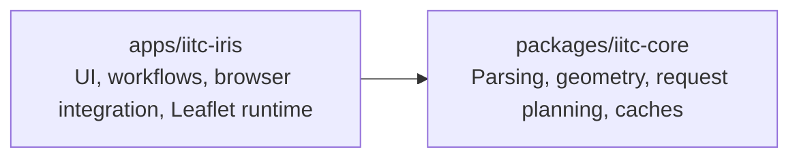

# IITC IRIS

A TypeScript/Preact/Leaflet browser extension for Ingress Intel, preserving IITC-CE behavior with explicit ownership,
focused modules, and a tested domain core.



## Repository

- `apps/iitc-iris/`: the application, component workbench, bundled assets, and extension packaging.
- `packages/iitc-core/`: IITC-compatible domain logic, without UI or browser-runtime dependencies.
- `docs/iitc-iris/`: architecture guidance, the APK plan, feature notes, and payload samples.
- `scripts/`: release version tooling.
- `reference/`: optional, ignored IITC-CE checkouts for comparison; not required to build.

Earlier IRIS/Mini-IRIS applications and their core/plugin libraries were removed after IITC-IRIS superseded them.
Their code and documentation remain available in Git history. The last commit before removal is
`aae62a6e896ab30aa4608562af05d4e16b0614bb`; for example, `git show <commit>:apps/iris/package.json`.
Useful payload samples were retained under `docs/iitc-iris/fixtures/`.

## Development

Use Node.js 24 (`nvm use` with the supplied `.nvmrc`) and npm.

```bash
npm ci
npm run check
npm run package
```

- `npm run dev`: watch the extension build. Load `apps/iitc-iris/dist` in your browser; this is not a hosted web page.
- `npm run dev:wb`: open the component workbench through Vite; `npm run build:wb` builds it separately.
- `npm run build`: check the core build and produce the unpacked extension.
- `npm run check`: lint, typecheck, and test both workspaces (including workbench sources), lint CSS, and build the workbench.
- `npm run lint`: lint both workspaces and application CSS.
- `npm run package` / `npm run release`: build Chrome ZIP and Firefox XPI artifacts locally; these do not publish.
- `npm run clean`: remove generated application output.

For focused commands, use npm workspaces, for example `npm run test -w packages/iitc-core`.
Only the two active workspaces are included; `package:iitc-iris` remains as a compatibility alias.
Commit the root `package-lock.json` when dependency resolution changes;
CI installs it with `npm ci` on Node 24.

## Load IITC IRIS Locally

Build with `npm run package`, then open `https://intel.ingress.com/` after loading the extension:

- Chrome/Chromium: open `chrome://extensions`, enable Developer mode, choose **Load unpacked**, and select
  `apps/iitc-iris/dist`.
- Firefox: open `about:debugging`, choose **This Firefox → Load Temporary Add-on**, and select
  `apps/iitc-iris/dist/manifest.json`.

Unpacked output is `apps/iitc-iris/dist/`. Packages are `apps/iitc-iris/builds/iitc-iris-chrome-<version>-<timestamp>.zip`
and `iitc-iris-firefox-<version>-<timestamp>.xpi`.

Required images and their attribution notices live in `apps/iitc-iris/assets/` and are included when packaging.
Reference payload samples are documented in [the fixtures note](docs/iitc-iris/fixtures/README.md). The application uses
live Intel data; retired fixture choices and empty fallback maps are no longer included.

`npm run version:bump -- X.Y.Z --no-tag` updates root/application versions, the manifest, and lockfile together.
Without `--no-tag`, the existing script also creates a local release tag. Commit reviewed version changes before pushing
any tag. CI checks, tests, and packages IITC IRIS; main pushes update the existing `latest` release, and version tags
trigger the tagged release workflow. Manual release runs require an existing `vX.Y.Z` tag and build that tag.

## Product Scope

IITC IRIS renders portals, links, fields, artifacts, ornaments, missions, and selected portal state. It includes portal
details, COMM, scores, inventory, passcodes, search, player tracker, Draw Tools v1 links/markers, and portal analysis.
Broad IITC plugin compatibility and Android APK hosting remain separate decisions. No Android project exists yet.

Start with the [documentation index](docs/README.md), [architecture](docs/iitc-iris/architecture.md),
[roadmap](docs/iitc-iris/plans/index.md), [port plan](docs/iitc-iris/port-plan.md),
[feature notes](docs/iitc-iris/features/), and [backlog](docs/iitc-iris/backlog.md).

## Attribution

The repository's existing declared license is GPL-3.0.

This independent project is not affiliated with or endorsed by Niantic. IITC-derived bundled assets and Leaflet assets
retain their notices in [assets/licenses](apps/iitc-iris/assets/licenses/). Existing source lineage and IITC behavior
references are documented in the port plan and feature notes.
